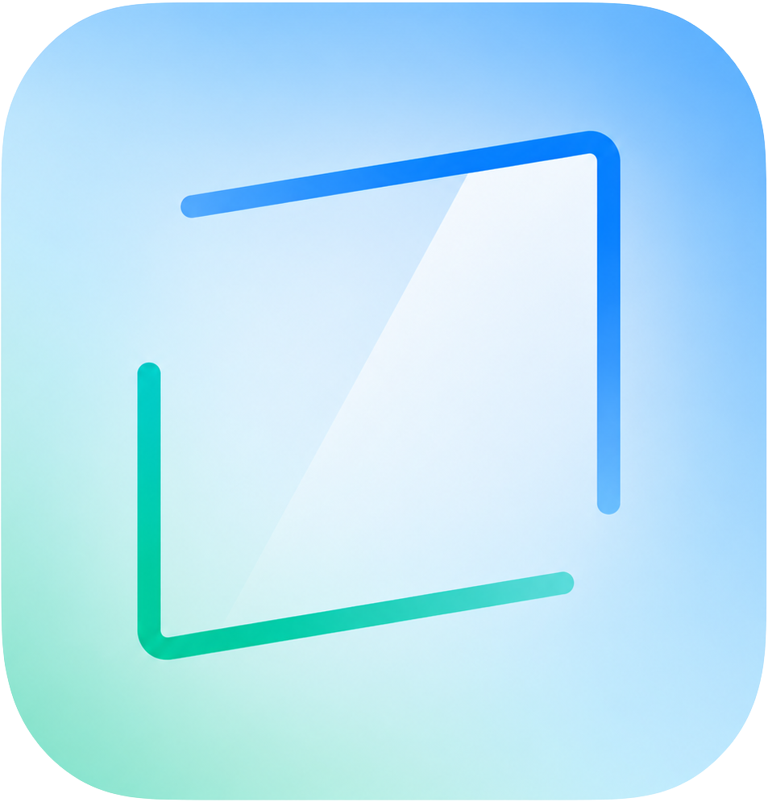
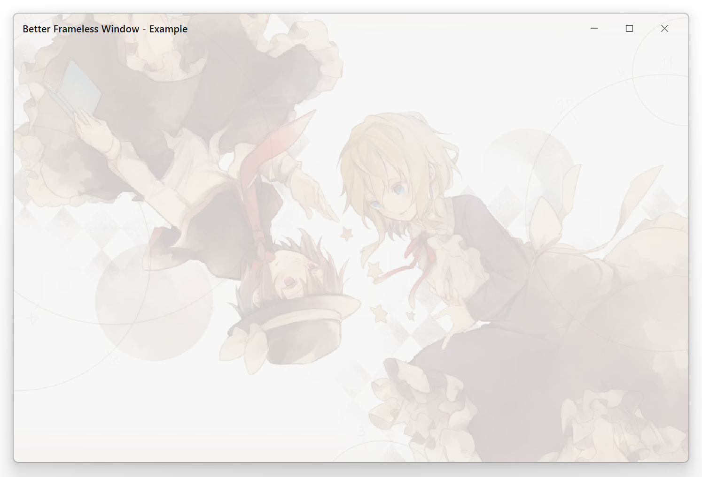
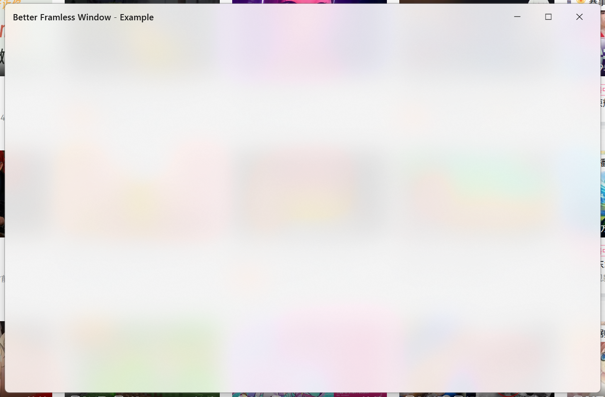

<p align="center">
  
</p>

<h1 align="center">better-frameless-window</h1>

<p align="center">
  A Qt6 · C++17 frameless window library for Windows
  <br>
  with DWM visual effects, background image, and theme support
</p>

<p align="center">
  
  
  
</p>

## Screenshots

<p align="center">
  
  <br><em>Background image with Cover mode</em>
  <br><br>
  
  <br><em>Acrylic backdrop</em>
</p>

## Features

- **Frameless window** — custom titlebar with icon, drag-to-move, double-click maximize/restore, right-click system menu, Alt+Space shortcut
- **8-direction resize** — HiDPI-aware hit testing with corner detection
- **Background image** — Cover / Fit / Stretch / Tile / Center modes with independent opacity control
- **DWM visual effects** — rounded corners and a Mica / Acrylic backdrop with auto fallback chain
  (the DWM frame shadow is available on opaque surfaces only, see *Known Issues*)
- **Snap Layout** — native DWM hit-test forwarding, toggleable via `setSnapLayoutEnabled()`
- **Theme manager** — Light / Dark with 300ms animated transitions, persistence, and system theme following
- **Titlebar customization** — visibility toggle, adjustable height, widget extension slot, caption buttons flush with the window edge
- **Smooth maximize / restore** — the geometry is animated (170ms, InOutCubic) before the window state flips
- **Fullscreen support** — auto-hides titlebar, disables resize edges
- **Window geometry persistence** — automatic save/restore with multi-monitor validation

## Requirements

| Component | Minimum |
|-----------|---------|
| Qt | 6.x (Core, Gui, Widgets) |
| CMake | 3.16+ |
| Compiler | MSVC 2022 |
| OS | Windows 10 1809+ (Windows 11 for Mica/rounded corners) |

## Build

```bash
cmake -B build -S .
cmake --build build --config Release
```

The build produces `better-frameless-window.lib` (static library) and `bfw-example.exe`.

## Quick Start

```cpp
#include <QApplication>
#include <QLabel>
#include "framelesswindow.h"

int main(int argc, char *argv[])
{
    QApplication app(argc, argv);

    FramelessWindow window;
    window.setWindowTitle("My App");
    window.setWindowIcon(QIcon(":/icon.png"));
    window.setWindowSizeLimits(QSize(480, 320), QSize());
    window.restoreWindowGeometry();

    auto *label = new QLabel("Hello!");
    label->setAlignment(Qt::AlignCenter);
    window.setCentralWidget(label);

    window.show();
    return app.exec();
}
```

## API Reference

### Window Configuration

| Method | Description |
|---|---|
| `setWindowSizeLimits(min, max)` | Set minimum / maximum window size |
| `minimumWindowSize()` / `maximumWindowSize()` | Get current size limits |
| `setCentralWidget(widget)` | Set the main content widget |
| `centralWidget()` / `takeCentralWidget()` | Get / remove the content widget |
| `saveWindowGeometry()` / `restoreWindowGeometry()` | Persist / restore window position and size |

### Titlebar

| Method | Description |
|---|---|
| `setWindowTitle(title)` | Set title text (auto-synced to titlebar) |
| `setWindowIcon(icon)` | Set window icon (displayed in titlebar) |
| `addTitleBarWidget(widget)` | Add a widget to the titlebar center area |
| `clearTitleBarWidgets()` | Remove all titlebar center widgets |
| `setTitleBarVisible(bool)` | Show or hide the entire titlebar |
| `isTitleBarVisible()` | Check titlebar visibility |
| `setTitleBarHeight(int)` | Set titlebar height in pixels (default 44) |
| `titleBarHeight()` | Get current titlebar height |
| `setMinimizeButtonVisible(bool)` | Show or hide the minimize button |
| `isMinimizeButtonVisible()` | Check minimize button visibility |
| `setMaximizeButtonVisible(bool)` | Show or hide the maximize button |
| `isMaximizeButtonVisible()` | Check maximize button visibility |
| `setCloseButtonVisible(bool)` | Show or hide the close button |
| `isCloseButtonVisible()` | Check close button visibility |

### Background Image

| Method | Description |
|---|---|
| `setBackgroundImage(pixmap, mode)` | Set background image with display mode |
| `clearBackgroundImage()` | Remove the background image |
| `backgroundImage()` | Get current background image |
| `backgroundImageMode()` | Get current background image mode |
| `setBackgroundOpacity(qreal)` | Set background image opacity (0.0–1.0), blends toward theme color |
| `backgroundOpacity()` | Get background image opacity |

**BackgroundImageMode** — `Cover` (default) / `Stretch` / `Fit` / `Tile` / `Center`

### Visual Effects

| Method | Description |
|---|---|
| `setShadowEnabled(bool)` | Enable / disable the DWM frame shadow (visible on opaque surfaces only) |
| `isShadowEnabled()` | Check shadow state |
| `setBackdropMode(mode)` | Request a backdrop; `None` switches it off |
| `backdropMode()` | Get the requested backdrop mode |
| `setRoundedCornersEnabled(bool)` | Enable / disable rounded window corners |
| `isRoundedCornersEnabled()` | Check rounded corners state |
| `setSnapLayoutEnabled(bool)` | Enable / disable Snap Layout overlay |
| `isSnapLayoutEnabled()` | Check Snap Layout state |
| `setBorderColor(color)` | Set the native window border color (`DWMWA_BORDER_COLOR`, Windows 11) |
| `borderColor()` | Get the current border color |

**BackdropMode** — `Auto` (default) / `None` / `Mica` / `Acrylic`

`Auto` resolves to the best backdrop the running OS supports:
Windows 11 22H2+ → Mica → Acrylic → None.

### Rendering rules

The window surface is resolved once, in `WindowVisualState::resolveSurfacePolicy()`,
and both the Qt side (translucency, theme wash) and the DWM side (backdrop kind)
are derived from that single result. The rules, highest precedence first:

| Rule | Result |
|---|---|
| Window is minimized | DWM drops the backdrop; the Qt surface stays translucent across the transition, because flipping that attribute mid-restore delays composition recovery |
| A background image is set | opaque, no backdrop (the image owns the surface) |
| `BackdropMode::None` | opaque, no backdrop |
| Backdrop requested and supported | translucent surface + that backdrop |
| Backdrop requested, nothing supported | opaque, no backdrop |

Consequences:

- A translucent surface always has a backdrop behind it, so the window can never
  show the desktop through an unbacked wash.
- Background image and backdrop never compete: setting an image drops the
  backdrop, so the two features can be used one after the other, not at once.
- The dark variant of the backdrop is not a switch. DWM reads it from
  `DWMWA_USE_IMMERSIVE_DARK_MODE`, which the library always keeps in sync with
  `themeMode()`; toggling it independently would paint the dark wash over light
  Mica and turn the window flat grey.

### Theme

| Method | Description |
|---|---|
| `setThemeMode(mode, persist, animated)` | Set Light / Dark theme with optional persistence and animation |
| `themeMode()` | Get current theme mode |
| `setAccentColor(color)` | Set accent color (used in titlebar button hover/pressed) |
| `accentColor()` | Get current accent color |
| `setFollowSystemTheme(bool)` | Auto-follow Windows dark/light setting |
| `followsSystemTheme()` | Check if system theme following is enabled |
| `syncThemeWithSystemIfFollowing()` | Re-read the Windows theme and apply it unanimated, when following is enabled and the theme changed |
| `themeTransitionProgress()` | Get current theme transition progress (0.0–1.0 Q_PROPERTY) |

### Theme Enums

**ThemeMode** — `Light` / `Dark`

### Diagnostics

| Method | Description |
|---|---|
| `setDiagnosticsEnabled(bool)` | Enable debug logging for DWM / visual effect calls |
| `isDiagnosticsEnabled()` | Check diagnostics logging state |

## Scope

Native window integration is Windows-only. The library builds and its tests pass
on Linux and macOS, but on those platforms the window is a plain frameless
widget: no native shadow, blur, backdrop, rounded corners, dark-mode titlebar or
Snap Layout. Porting those is tracked in #7 (Linux) and #8 (macOS).

## Known Issues

| Issue | Details |
|---|---|
| Snap Layout may not appear | Depends on `HTMAXBUTTON` hit-test forwarding; toggle with `setSnapLayoutEnabled(true)` |
| Resize jitter | Slight jitter while dragging a window edge; the native resize loop and DWM own that frame, and further suppression did not remove it without breaking resize continuity |
| Mica can look like a solid background | Mica does not blur what is behind the window; it samples the desktop wallpaper, desaturates it and applies a near-neutral tint (`#f3f3f3` light, `#202020` dark). On a light, low-contrast wallpaper the light variant differs from the theme background by ~2 RGB levels, so it is invisible to the eye. Check `DWMWA_SYSTEMBACKDROP_TYPE` (2 = Mica) instead of trusting the screenshot. |
| Shadow is not drawn on a backdrop surface | DWM only paints its frame shadow for windows without per-pixel alpha. A Mica/Acrylic surface is layered, so `setShadowEnabled()` has no visible effect there; it applies as soon as the window is opaque (`BackdropMode::None`). The library logs this through `setDiagnosticsEnabled(true)`. |
| Acrylic is a flat tint on Windows 11 | The library falls back to `ACCENT_ENABLE_ACRYLICBLURBEHIND`, which no longer blurs on Windows 11; it renders as a solid tint. Mica is the supported material there. |
| Accent color is not animated | Theme changes animate over 300ms, `setAccentColor()` applies immediately (#12) |
| Window state is per library, not per app | Window geometry and theme are stored under the library's own settings key, so applications using the library share one record |

## Documentation

| Document | Contents |
|---|---|
| [docs/architecture.md](docs/architecture.md) | Layer map, the resolved-surface model, state machine, naming rules |
| [docs/release-checklist.md](docs/release-checklist.md) | Manual regression pass to run before tagging a release |
| [docs/todo.md](docs/todo.md) | Open work: materials, platform coverage, API polish |
